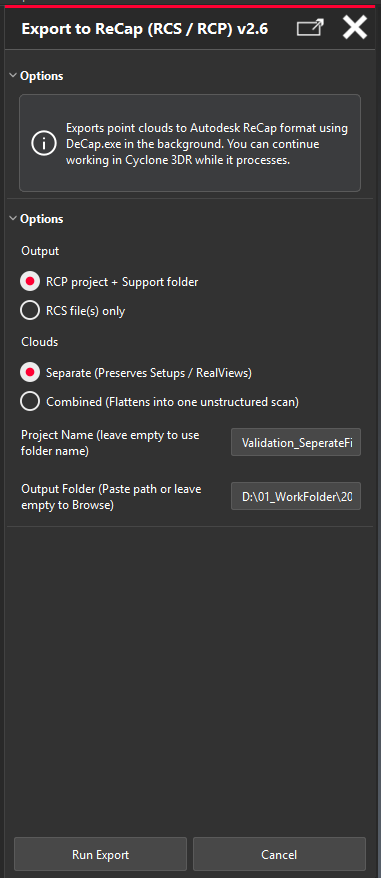

# Cyclone 3DR to Autodesk ReCap Exporter (v2.6)

A seamless, 1-click script for Leica Cyclone 3DR that completely automates the tedious export-to-ReCap workflow. 

Instead of exporting `.e57` files, opening Autodesk ReCap, importing them manually, waiting for the indexing to finish, and saving the project—this script handles the entire pipeline in the background while you continue working in 3DR.

## 🚀 How it Works
1. Select one or more point clouds (and optionally images) in Cyclone 3DR.
2. Run the script and choose your export options (RCP vs RCS, Combined vs Separate).
3. The script exports temporary high-quality `.e57` files (matching and bundling any associated panoramic `SImage` setups). Panoramic heading is automatically aligned (+90° yaw) in the background so RealViews match point clouds perfectly.
4. The script dynamically generates a PowerShell worker and launches Autodesk's command-line engine (`DeCap.exe`) in the background.
5. `DeCap.exe` indexes the point clouds into native `.rcp` or `.rcs` formats.
6. The background process safely cleans up the temporary `.e57` files once indexing is complete.

## ⚠️ Prerequisites
**You MUST have Autodesk ReCap Pro installed and licensed on your machine.**
This script hooks directly into `DeCap.exe` (Autodesk's command-line processing engine), which requires a valid ReCap Pro license to operate.

Default installation path expected by the script:
`C:\Program Files\Autodesk\Autodesk ReCap\DeCap.exe`

## ⚙️ Options
* **Output Mode:** Choose whether you want a full `.rcp` project with a support folder (best for dropping straight into Revit/Navisworks), or just raw standalone `.rcs` files.
* **Cloud Grouping:** 
  * **Separate (Preserves Setups / RealViews):** Converts each selected 3DR point cloud into its own individual scan within ReCap. Automatically pairs and includes matching panoramic images for RealView construction.
  * **Combined (Flattens into one unstructured scan):** Unifies all selected 3DR point clouds into a single clean unstructured scan during export.
* **Project Name:** Specify a custom project name, or leave it blank to automatically use the output folder's name.
* **Output Folder:** Paste your target path directly, or leave it blank to browse for a folder manually.

## 📷 Automated RealView Alignment & Stability
* **Silent +90° Heading Correction:** In the background, the script automatically applies the exact +90° camera yaw correction required between Leica (+Y forward) and Autodesk ASTM E57 (+X forward) standards, then restores your Cyclone 3DR document camera parameters immediately afterward. No user intervention or manual rotation settings required.
* **Multi-Scan Stability:** Automatically configures `--e57EnableImageImport` for complete RealView panoramic rendering while preventing excessive depth-grid memory consumption during multi-scan parallel indexing.

## 💻 Background Processing & Productivity
Because all indexing is handed off to PowerShell and `DeCap.exe` in a separate process:
* **Cyclone 3DR remains completely free and unfrozen.**
* You can continue working, editing point clouds, saving projects, or queuing up additional exports in 3DR immediately after launching.
* A visible command console displays real-time indexing progress and automatically closes once completed.

## 💡 Notes on ReCap File Structure & Registration
* **The Support Folder:** A standard ReCap project creates a `.rcp` file and a `Support` folder. The `Support` folder contains the actual `.rcs` scan files. It also creates a `Temporary Cache Files` folder inside it, which is normally empty (0 bytes) unless ReCap is actively processing. This is normal and expected behavior.
* **Structured Data & RealView Panoramas:** v2.6 discovers matching panoramic images (`SImage`) in your 3DR workspace (via naming conventions or spatial camera position) and embeds them directly into the E57 export with `--e57EnableImageImport`. It temporarily applies the RealView yaw correction directly to external camera parameters and restores your Cyclone 3DR project orientation with 100% mathematical fidelity in a guaranteed `finally` block.

## ☑️ Tested Version
Tested on Leica Cyclone 3DR 2026.1 (and compatible with newer versions).

## 📄 Licensing
Compatible with all editions of Cyclone 3DR (Standard, Survey, AEC, Tank).
Distributed under the MIT License.

## ✉️ Support & Contact
Created by Thomas Mathey
**Email:** thomas@globalsurvey.co.nz
